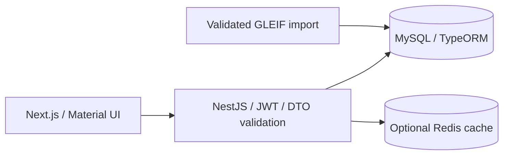

# Commercial DA — Entity Governance Workspace

A full-stack workspace for exploring legal entity records, corporate relationships and evidence-based review workflows using public [GLEIF](https://www.gleif.org/) data.

**[Live application](https://analytics.imrocky.com)** · **[Author's portfolio](https://imrocky.com)** · [Detailed Chinese documentation](README.zh-CN.md)

This is an independent portfolio application inspired by engineering concepts explored during a software development internship. It does not contain an employer's private business data or represent an employer's production system.

## What it does

- Explore legal entities with combined name, region, registration, renewal and review filters.
- Traverse parent–subsidiary accounting consolidation relationships, with source references and reporting exceptions.
- View management summaries and SQL aggregation across hierarchy levels and geographies.
- Assign reviewers, set deadlines and record evidence with role-based access.
- Detect source changes and reject concurrent or stale-evidence review updates.
- Export matching entity records and share filtered views.

## Architecture



Source evidence and internal review history are stored separately. Imports and review writes coordinate through dataset locking and version checks. The optional cache covers stable public aggregation; it is disabled by default.

## Local setup

Requires Node.js 20 or newer, npm, Python 3 and a separate MySQL 8 database. Node.js 24 is used in the deployment environment.

1. Copy `backend/.env.example` to `backend/.env` and `frontend/.env.example` to `frontend/.env.local`. Set your own database credentials, a random JWT secret and administrator credentials. Never commit these local files.
2. Create a dedicated development database and user, or configure the local `compose.yaml` using your own environment values.
3. Install and initialize against an **empty development database**:

```sh
cd backend
npm ci
npm run registry:fetch
npm run db:init
npm run registry:import
npm run seed:admin
npm run start:dev
```

4. Start the frontend in a second terminal:

```sh
cd frontend
npm ci
npm run dev
```

The frontend defaults to port 3000 and API to 3001. Database initialization is for a new database; do not run it against a production database or another application's schema. Generated GLEIF snapshots are intentionally excluded from Git and recreated by `registry:fetch`.

## Verification

```sh
cd backend
npm test
npm run build
cd ../frontend
npm ci
npm run typecheck
npm run build
```

Database integration tests require an explicitly enabled, dedicated `test_` database and may reset its contents. See the detailed documentation before running them. Commands above describe the project's checks; this source publication does not claim a fresh full application acceptance run.

## Data interpretation and limits

GLEIF accounting consolidation relationships do not establish ownership percentages, credit ratings or customer relationships. An expired LEI registration does not imply bankruptcy. Collection is bounded and is not a complete company registry. Historical benchmark reports describe their own datasets and environments; they are not performance guarantees for this application.

This repository contains application source and environment templates. Secrets, deployment credentials, private Git history, generated data, database backups, local runtime files and production infrastructure are excluded. Production infrastructure is managed separately.
